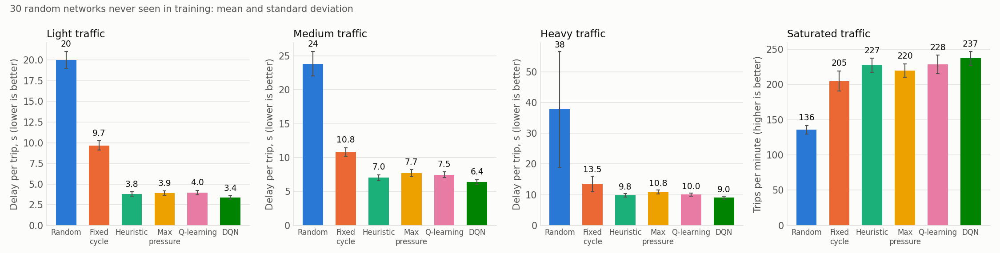

🚦🚗🚛🏍️ Traffic Simulator
==============================

**Road traffic simulation with ML-optimized traffic lights for maximum flow.**


## What is Traffic Simulator?

Traffic Simulator generates a random traffic network based on user-defined parameters, and uses machine-learning methods to optimize traffic lights for better flow.

Simply set your parameters and watch the magic happen ✨.

## 🚀Quick start
This project uses CMake for easy cross-platform builds.

### Clone/Download the repo
```cmd
git clone https://github.com/ninja7v/Traffic-Simulator.git
cd Traffic-Simulator
```
### Compile and run
```cmd
cmake -S . -B build
cmake --build build
```

Or even faster in Visual Studio Code: open the project and hit F5.

Once launched, a window pops up with a random traffic network running until you close it. Run it from the repository folder (or from `build/`) so that the trained models in `models/` are found; otherwise the learning controllers start learning from scratch.

The **Boost** slider only makes the simulation run faster (more steps per frame): the traffic model, and so the results, are the same at any boost.

## 🧠Methods & results
Every intersection decides which incoming road gets the green light, once per traffic light period (2 simulated seconds). The control panel lets you pick the controller:

| Controller | What it does |
|---|---|
| Random *(baseline)* | A random road at every decision. |
| Fixed cycle *(baseline)* | Each road in turn, whatever the traffic. |
| Heuristic | Hand-written rules: keep the green while traffic flows, otherwise serve a full road first, then the busiest road whose vehicles can actually leave. |
| Max pressure | Rule from the literature: serve the road with the most vehicles compared to the roads they are going to. |
| Q-learning | Reinforcement learning with a table. |
| DQN (Deep Q-Network) | Reinforcement learning with a neural network. **Default.** |

The two learning controllers are trained beforehand on random networks with random traffic (`train` tool) and shipped in `models/`. They score the decision "give the green light to this road" from the point of view of that road, so a single model drives every intersection of any network. Their reward is the opposite of the number of vehicles waiting at the intersection. Details in [docs/MODEL.md](docs/MODEL.md).

### Results
30 random networks that were **never used for training**, the same networks and the same vehicles for every controller, 20 simulated minutes each. Delay is the time lost per trip compared to an empty network without lights (mean ± standard deviation over the networks):

| Controller | Light (60 veh/min) | Medium (120 veh/min) | Heavy (180 veh/min) | Saturated: trips/min |
|---|---|---|---|---|
| Random *(baseline)* | 20.0 s | 23.8 s | 37.8 s | 136 |
| Fixed cycle *(baseline)* | 9.7 s | 10.8 s | 13.5 s | 205 |
| Max pressure | 3.9 s | 7.7 s | 10.8 s | 220 |
| Heuristic | 3.8 s | 7.0 s | 9.8 s | 227 |
| Q-learning | 4.0 s | 7.5 s | 10.0 s | 228 |
| **DQN** | **3.4 s** | **6.4 s** | **9.0 s** | **237** |



- **DQN is better than the random baseline and than the fixed cycle on 30 networks out of 30 in every scenario** (delay divided by 4 to 6 compared to random), and better than the hand-written heuristic on 119 of the 120 runs.
- Q-learning is far better than both baselines (30/30) and level with the heuristic: a table with a few levels cannot do much better than good hand-written rules.
- Known limit: when far more vehicles are sent than the network can take, with enough vehicles allowed in to fill it (`overload` scenario), every traffic-responsive controller sometimes ends in gridlock (DQN: 3 networks out of 30, heuristic: 7, max pressure: 20). See [docs/MODEL.md](docs/MODEL.md).

To reproduce (a few minutes):
```cmd
./build/train dqn
./build/train qlearning
./build/benchmark --seeds 30 --csv docs/results/benchmark.csv
python3 tools/plot_results.py
```
`train` is deterministic: it rewrites exactly the models of the repository. `benchmark` options are listed at the top of `tools/benchmark.cpp`.

## 📖Documentation
This code is well commented for [Doxygen](https://www.doxygen.nl/index.html).
You can generate a complete documentation set using Doxygen.

The simulation model, the controllers, the reward and the experiments are described in [docs/MODEL.md](docs/MODEL.md).

More explanations and details are available in the project [Wiki](https://github.com/ninja7v/Traffic-Simulator/wiki)

## ✍️Contribute
Ideas, bug reports, or pull requests — all are welcome. Let’s build something awesome together!

Now it's your turn to generate traffic jams.

Thank you for using Traffic Simulator 🙂

> Just simulate !

## Licensing

This project is licensed under the MIT License - see the LICENSE.txt file for details.
