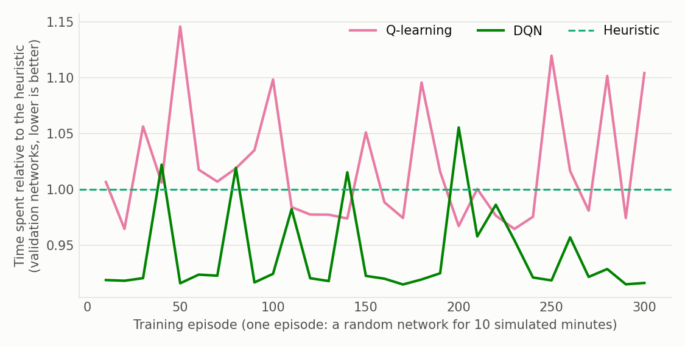
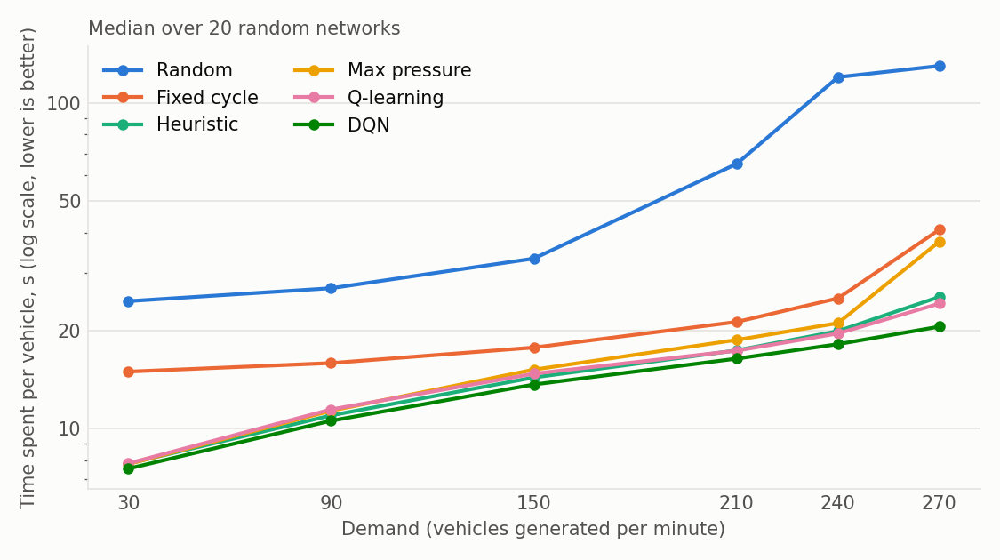

# Model, controllers and experiments

This page describes what the simulator computes, how the traffic lights are controlled and
learned, and how the results of the README were measured.

## 1. Simulation model

### Network
- `nbIntersections` (11) intersections at random positions, at least `minGap` apart.
- Roads are the sides of the Delaunay triangulation of the intersections. Each one is one-way
  with probability `oneWayRoadRatio` (0.3), two-way otherwise; one-way roads are made two-way
  where needed so that every intersection can be reached from any other.
- A road has one lane. Vehicles cannot overtake.

### Time
The simulation advances by a fixed step of 1/60 s (`constants::timeStep`). Speeds and
accelerations are constants expressed per step. **The boost only changes how many steps are
computed per displayed frame**: the model is strictly the same at any boost and any frame rate.

### Vehicles
- Three types (car, bike, truck) with their own maximum speed, acceleration and length.
- Free road or green light ahead: the vehicle accelerates up to its maximum speed.
- Vehicle or red light ahead at distance `d`: the speed follows
  `v(d) = vmax * d² / (d² + 5 * distanceSecurity)`, and the vehicle stops when `d` is below
  `distanceSecurity`. Queues therefore form behind a red light and take time to restart at the
  green: switching the lights has a cost, without any explicit yellow phase.
- A vehicle enters the next road of its itinerary only if there is room at its start. Otherwise
  it waits at the intersection, blocks its own road (spillback), and looks for another route.
- Itineraries are shortest paths (Dijkstra) on road lengths plus a penalty for roads whose queue
  reaches their start. An itinerary never starts with a U-turn on the road the vehicle comes
  from, unless there is no other way.

### Traffic lights
At an intersection, exactly one incoming road has the green light. Every `trafficLightPeriod`
(2 s), the controller of the intersection chooses which one. An intersection with a single
incoming road is always green.

### Demand
Vehicles are generated by a Poisson process of `demand` vehicles per simulated minute. Each
one gets a uniformly random origin road, destination intersection and type. A vehicle enters
when its origin road has room and fewer than `nbVehicleMax` vehicles are in the network;
meanwhile it waits outside (first generated, first served; at most 300 waiting, the next ones
are rejected and counted).

The demand has its own random number generator: **for a given seed, the network and the
generated vehicles are the same whatever the controller does.**

### Simplifications to keep in mind
- One lane per road, one green road per intersection: no turning lanes, no compatible
  movements served together, no pedestrian.
- No yellow or all-red phase; the cost of switching only comes from the vehicles restarting.
- An intersection is a point: a vehicle that crosses it appears at the start of its next road.
- The demand is uniform in space and constant in time.

## 2. Measures

`Network::getStats()` returns a `TrafficStats`, printed by the `benchmark` tool:

| Measure | Definition |
|---|---|
| `time_spent` | Vehicle.seconds spent in the network or waiting to enter it, per generated vehicle. Counts the vehicles that did not arrive, so a controller cannot improve it by leaving vehicles behind. **Main measure.** |
| `delay` | Travel time minus the travel time on the same route at maximum speed, per completed trip |
| `travel_time`, `p95_travel`, `max_travel` | Mean, 95th percentile and maximum travel time of the completed trips |
| `flow` | Completed trips per minute |
| `queue`, `max_queue` | Average number of vehicles waiting (slower than 10 % of their maximum speed) in the network; largest queue on one road |
| `speed` | Average speed relative to the maximum speed |
| `rejected` | Vehicles dropped because 300 were already waiting outside |

Below saturation, every controller completes the same trips, so the flow equals the demand and
says nothing: delay and time spent are the measures to compare. In the `saturated` scenario
the network is always full, and the flow measures its capacity.

## 3. Controllers

All controllers implement `IntersectionOperator::decide(observation)`. The observation
(`Intersection::observe`) contains, for each incoming road: number of vehicles, number of
waiting vehicles, waiting time and distance to the light of the first vehicle, whether this
vehicle could leave (its next road has room), whether the queue fills the road, and the average
number of vehicles on the roads its vehicles are going to; plus the current green road and for
how long it has been green.

- **Random**, **fixed cycle**: baselines.
- **Heuristic**: keep the green while a vehicle that can leave is at the light; otherwise a
  full road first, then the road with the most vehicles, among the roads whose first vehicle
  can leave.
- **Max pressure**: road maximizing (its vehicles − vehicles downstream), with a margin to
  avoid switching for a small gain.
- **Q-learning** and **DQN**: below.

### What is learned
Both learning controllers learn `Q(situation, decision)`: the expected discounted sum of
future rewards of the decision "give the green light to road *a*".

The decision is described **from the point of view of road *a*** (`src/Features.cpp`): its own
traffic, the traffic of the road that is green now, and a summary of the other roads. This
description does not depend on the order nor on the number of roads, so **one model is shared
by all the intersections and applies to any network**: this is what allows training on some
networks and using the result on others.

- DQN: 16 real features → network 16-32-32-1 (leaky ReLU, Adam, Huber loss), evaluated once
  per candidate road. Double DQN, replay buffer of 50 000 transitions, batches of 32, target
  network copied every 500 steps, discount 0.95.
- Q-learning: the same information reduced to a few levels (3 456 table entries). Learning rate
  1/visits down to 0.01, discount 0.5. One of the levels is the load of the whole intersection:
  without it, the table mixes up "this road is busy" with "the situation is bad", and learns
  to avoid busy roads (see §5).

Two rules restrict the candidate roads of both learning controllers (`features::usefulActions`),
also while exploring:
1. a road whose first vehicle cannot leave (empty, or blocked by a full next road) is not a
   candidate when another road can be served;
2. if roads filled by their queue can be served, only they are candidates (a full road blocks
   the intersection it comes from).

They were added after measuring that the learned policies sometimes held the green on a blocked
road in congested situations never met in training, which froze the network.

### Reward
For the decision taken at an intersection, over the 2 s until the next decision
(`Intersection::reward`):

```
reward = − (average number of vehicles waiting on the incoming roads) / 10
         + (vehicles that crossed the intersection) / 20
         − max(longest wait of a first vehicle − 30 s, 0) / 60
```

The first term is the local part of the network objective (total time lost). The measured
effect of the terms, DQN retrained with each variant (time spent per vehicle, 10 networks,
2 training seeds):

| Reward | Light | Medium | Heavy | Saturated |
|---|---|---|---|---|
| All three terms (kept) | 8.3 s | 10.9 s | 13.3 s | 86.7 s |
| Waiting vehicles only | 8.2 s | 11.0 s | 13.4 s | 87.0 s |
| Waiting vehicles + departures | 8.2 s | 11.0 s | 13.4 s | 86.9 s |
| Original: departures/5 − waiting/20 | 8.8 s | 11.4 s | 13.6 s | 87.3 s |
| Departures only | 23.4 s | 29.6 s | 29.4 s | 147.2 s |

(Measured before the last routing change, hence absolute values slightly different from the
README.) The waiting term carries the signal; the two others make no measurable difference and
are kept as a guard against starving a quiet road. A reward made of departures only does not
work: over 2 s it barely depends on the decision.

### Training
`tools/train.cpp`. An episode is a new random network simulated for 10 minutes with random
conditions: demand uniform in 40–300 vehicles/min, or (30 % of the episodes) a network kept
full with a limit of 50 to 200 vehicles. An episode ends early if the network is gridlocked.
The exploration rate decreases from 1 to 0.05 over the first 60 % of the training. Every 10
episodes the controller is evaluated without exploration on 4 validation networks × 5
scenarios, and the best model is kept.

Training, validation and benchmark networks use distinct seeds. Training is deterministic
(bit-identical models for the same seed) and takes about 3 min 20 s for the DQN and 1 min 20 s
for Q-learning (300 episodes, one core).



The DQN is already better than the heuristic after 10 episodes. The peaks are single
validation runs ending in gridlock in the overload scenario (§4).

## 4. Experiments

All numbers come from `benchmark` (5 minutes of warm-up, then 20 measured minutes, seeds 1 to
30 or 1 to 20). Raw results: `docs/results/`.

### Main benchmark (30 networks, time spent per vehicle, mean ± standard deviation)

| Controller | Light | Medium | Heavy | Saturated |
|---|---|---|---|---|
| Random | 25.8 s | 29.8 s | 44.0 s | 163.7 s |
| Fixed cycle | 15.5 s | 16.7 s | 19.6 s | 108.8 s |
| Max pressure | 9.7 s | 13.6 s | 16.9 s | 101.1 s |
| Heuristic | 9.6 s | 12.9 s | 15.8 s | 97.8 s |
| Q-learning | 9.7 s | 13.4 s | 16.1 s | 97.5 s |
| DQN | 9.1 s | 12.3 s | 15.1 s | 93.7 s |

Networks (out of 30) on which the learning controllers are better than:

| | Random | Fixed cycle | Heuristic |
|---|---|---|---|
| DQN | 30 / 30 / 30 / 30 | 30 / 30 / 30 / 30 | 30 / 29 / 30 / 30 |
| Q-learning | 30 / 30 / 30 / 30 | 30 / 30 / 30 / 29 | 4 / 0 / 4 / 22 |

(light / medium / heavy / saturated). 30 wins out of 30 paired comparisons is a Wilcoxon
signed-rank p-value of 2·10⁻⁹.

### Other conditions (20 networks each, never used in training)

Median time spent per vehicle; in brackets, the number of networks where the DQN is better
than random / fixed cycle / heuristic.

| Condition | Random | Fixed | Heuristic | Q-learning | DQN |
|---|---|---|---|---|---|
| Demand 30 /min | 24.6 | 15.0 | 7.8 | 7.8 | 7.5 (20/20/19) |
| Demand 90 /min | 27.0 | 15.9 | 11.0 | 11.5 | 10.6 (20/20/20) |
| Demand 150 /min | 33.3 | 17.8 | 14.4 | 14.8 | 13.7 (20/20/20) |
| Demand 210 /min | 65.0 | 21.3 | 17.4 | 17.4 | 16.4 (20/20/20) |
| Demand 240 /min | 120.0 | 25.1 | 19.9 | 19.6 | 18.2 (20/20/19) |
| Demand 270 /min | 129.9 | 40.9 | 25.4 | 24.2 | 20.6 (20/20/19) |
| Two-way roads only, medium | 29.8 | 17.0 | 12.2 | 12.7 | 11.6 (20/20/20) |
| Two-way roads only, heavy | 34.9 | 18.0 | 14.9 | 15.4 | 14.2 (20/20/20) |
| 70 % one-way, medium | 29.4 | 16.3 | 13.5 | 13.6 | 12.9 (20/20/20) |
| 70 % one-way, heavy | 55.6 | 21.6 | 17.6 | 17.1 | 16.5 (20/20/19) |
| One-way wherever possible, medium | 53.8 | 21.1 | 14.6 | 14.6 | 14.1 (20/20/20) |
| One-way wherever possible, heavy | 178.7 | 137.2 | 24.0 | 22.3 | 22.3 (16/15/16) |
| Decision every 1 s, medium | 21.6 | 13.9 | 10.2 | 10.4 | 8.9 (20/20/20) |
| Decision every 1 s, heavy | 29.0 | 19.2 | 12.9 | 13.2 | 11.3 (20/20/20) |
| Decision every 4 s, medium | 49.3 | 23.9 | 19.8 | 21.2 | 19.8 (20/20/11) |
| Decision every 4 s, heavy | 146.0 | 26.3 | 24.0 | 25.4 | 23.3 (20/20/18) |
| Always full, limit 100 vehicles | 143.1 | 100.4 | 91.9 | 89.9 | 87.1 (20/20/19) |
| Heavy, 120 minutes (10 networks) | 37.8 | 18.3 | 15.5 | 15.8 | 14.9 (10/10/10) |



The models were trained with 30 % of one-way roads and a decision every 2 s only.

### Limit: gridlock under overload
`overload` scenario: 600 vehicles/min sent, up to 150 in the network, 30 networks.

| | Random | Fixed | Heuristic | Max pressure | Q-learning | DQN |
|---|---|---|---|---|---|---|
| Gridlocked networks | 0 | 0 | 7 | 20 | 3 | 3 |
| Mean flow (trips/min) | 203 | 266 | 239 | 96 | 264 | 265 |
| Better than random on | – | 30 | 23 | 13 | 27 | 25 |

A gridlock is a ring of full roads, each first vehicle waiting for room on the next road:
no traffic light decision can undo it. The controllers that follow the traffic move vehicles
faster to the centre of the network and fill its short roads; the baselines are protected by
their own inefficiency (their vehicles queue at the edges). With the networks that do not lock,
the DQN remains the best. Preventing gridlock needs to hold vehicles back before the centre
fills, which a controller that only sees its own intersection, with a horizon of a few tens of
seconds, does not learn. The same happens in 2 networks out of 20 with one-way roads only and
heavy traffic.

## 5. What changed from the previous version, and why

Measured on the previous code (same 30 network layouts, network kept full with 70 vehicles,
controllers learning online for 60 minutes, flow of the last 10 minutes):

| Previous version | Random | Fixed cycle | Heuristic | Q-learning | DQN |
|---|---|---|---|---|---|
| Trips/min | 138 ± 11 | 200 ± 22 | 182 ± 92 | 199 ± 11 | 228 ± 10 |

Q-learning, the default method, ended **level with a plain fixed cycle** after an hour of
learning (and below it during the first 10 minutes: 167), the DQN ended level with the
heuristic of the time on the networks where the latter did not lock up, and both had to learn
again on every network. The flows of the two versions cannot be compared directly (the demand
and the routing changed); within the new version, in the equivalent `saturated` scenario and
without any learning on the tested networks: Q-learning 228 and DQN 237, for a fixed cycle
at 205.

Causes found, each measured before being fixed:

1. **The boost changed the physics.** Speeds were multiplied by the boost, accelerations by
   the boost instead of its square, and the light period divided by it: at boost ≥ 2 vehicles
   no longer had time to start during a green. The flow displayed for the heuristic fell from
   222 trips/min (boost 1) to 36 (boost 10), and the fixed cycle became equal to random.
   Learning faster with the boost meant learning another, broken, model. *Fix: the boost only
   sets the number of steps per frame.*
2. **State and actions did not mean the same thing from one intersection to the other.** One
   table / network was shared by all the intersections, but the state listed the roads by index
   and the action was a road index: "road 2" is a different road everywhere. The state was
   also coarse (3 levels per road, nothing on blocked roads). *Fix: decisions described from
   the point of view of the road (§3).*
3. **Learning was online only, mixed with the evaluation, and never reused.** Every run
   restarted from random decisions, kept exploring while being measured, and needed tens of
   simulated minutes per network. *Fix: `train` tool, models shipped in `models/`, evaluation
   without exploration on other networks.*
4. **Experiments were not reproducible nor comparable.** The learners were seeded with
   `std::random_device`, the neural network and the traffic shared `rand()`, and vehicles were
   generated according to the room left by the controller: two controllers never saw the same
   traffic, and the same run gave 173 to 178 trips/min. *Fix: separate seeded generators,
   demand independent of the controller.*
5. **The only measure was the flow of a network kept full,** which hides the vehicles left
   waiting (one vehicle waited nearly 6 minutes under the DQN, for an average trip of 19 s) and cannot
   describe traffic below saturation. *Fix: measures of §2.*
6. **Q-learning confused "busy road" with "bad situation"** once the decisions were described
   road by road: its validation score went from 1.4 times the heuristic's time to 0.96 after
   adding the load of the whole intersection to its state and shortening its horizon.
7. **Routing produced U-turns** (trips back to their origin, vehicles sent back when blocked):
   two full opposite roads then blocked each other for ever. *Fix: no immediate U-turn.*
8. The reward was not the main problem (§3, reward table): the original formula performs
   within 5 % of the new one once the state is fixed.
